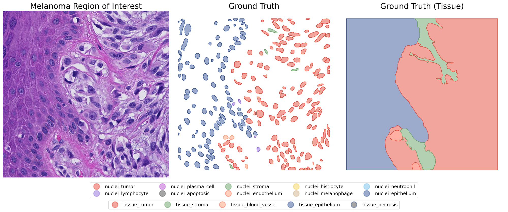
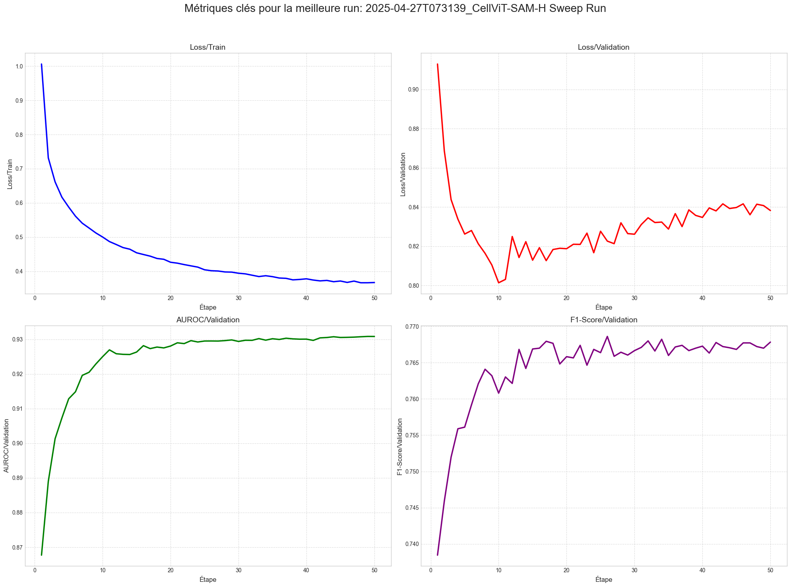

# Deep Learning for Melanoma Histopathology

**Nuclei classification and tissue segmentation using the PUMA dataset.**

This repository contains our deep learning project at **INSA Rouen Normandie (2025)**, developed by **Alix ANNERAUD and Quentin Béral**. We explored how existing medical imaging models can be adapted to identify cell nuclei and tissue regions in histopathology images of advanced melanoma.

The work covers dataset conversion, model training on a GPU cluster, hyperparameter tuning, and analysis of the results. It builds on **CellViT++**, **nnU-Net**, and **HoVer-Net** rather than introducing a new neural network architecture.



*Example from the PUMA dataset and its annotations, as shown in our project presentation.*

## The problem

The [PUMA challenge](https://puma.grand-challenge.org/) focuses on **panoptic segmentation of nuclei and tissue in melanoma**. It involves two related tasks:

- **Nuclei:** locate individual cell nuclei and identify their type, including tumor cells, lymphocytes, and other cell populations.
- **Tissue:** segment and classify larger regions, such as tumor, stroma, and other tissue structures.

PUMA provides H&E-stained image regions with expert-reviewed annotations. The dataset includes 1,024 × 1,024-pixel regions of interest, associated context images, and nucleus/tissue annotations in GeoJSON format.

[Dataset and access instructions](https://puma.grand-challenge.org/dataset/) · [PUMA dataset paper](https://doi.org/10.1093/gigascience/giaf011)

## What we implemented

| Approach | Work in this repository | Outcome |
| --- | --- | --- |
| **[CellViT++](https://github.com/TIO-IKIM/CellViT-plus-plus)** | Convert PUMA annotations, train a nucleus classification head, and tune hyperparameters with Weights & Biases. | Training and validation results documented below. |
| **[nnU-Net](https://github.com/MIC-DKFZ/nnUNet)** | Prepare PUMA and NSCLC datasets, customize training, and set up an NSCLC pretraining → PUMA fine-tuning workflow. | Training was blocked by GPU/environment issues; no comparable result is reported. |
| **[HoVer-Net](https://github.com/vqdang/hover_net)** | Prepare image patches and annotation masks, with a cluster training script. | Experimental integration; no benchmark result is reported here. |

The implementation includes **Python preprocessing scripts**, **GeoJSON-to-mask conversion**, **custom training configurations**, and **SLURM jobs** for the cluster runs.

## Results

Our main completed experiment used **CellViT++ with a CellViT-SAM-H backbone** and a trained classification head. We explored hyperparameters with Weights & Biases and inspected the validation curves.

| Validation metric | Approximate value reported in our presentation |
| --- | ---: |
| AUROC | **0.93** |
| F1 score | **0.77** |
| Average precision | **0.45** |



*CellViT++ training and validation curves from the project presentation.*

These are **validation observations from the project**, not independent test-set or PUMA leaderboard results. The nnU-Net experiment did not complete because the training process stalled in the cluster environment, and we did not obtain a directly comparable three-model benchmark.

The experiments also highlighted practical challenges beyond model selection: class imbalance, GPU availability, dependency compatibility, and reproducibility.

## Repository structure

```text
.
├── cellvit_plus_plus/   # PUMA conversion, CellViT++ config and classifier training
├── nnunet/              # PUMA/NSCLC conversion, custom trainers and nnU-Net jobs
├── hovernet/            # Mask/patch preprocessing and HoVer-Net job
├── diaporama/           # Project presentation, plots and experiment notebooks
└── .dvc/                # DVC configuration
```

The original model implementations are included as **Git submodules**. The notebooks and plots used for the presentation are in [`diaporama/`](diaporama/).

## Getting started

The project uses [uv](https://docs.astral.sh/uv/) for Python environments, with **separate dependencies for each model**. There is no shared root-level Python environment.

Clone the repository with its submodules:

```bash
git clone --recurse-submodules https://github.com/AlixANNERAUD/Deep_learning_project.git
cd Deep_learning_project
```

Set up the environment for the approach you want to explore:

```bash
cd cellvit_plus_plus
uv sync
```

For another model, run `uv sync` inside `nnunet/` or `hovernet/` instead. Each directory contains its own `pyproject.toml` and `uv.lock`.

For example, the CellViT++ segmentation dataset conversion script supports:

```bash
cd cellvit_plus_plus
uv run prepare_puma_for_cellvit_segmentation.py --help
```

You will need to obtain the datasets separately, set the appropriate input/output paths, and review the **PUMA label mappings** in the conversion scripts before generating training data. The checked-in mappings are not fully configured.

### GPU / cluster training

Training scripts are provided for SLURM:

- [CellViT++ classifier](cellvit_plus_plus/train_cellvit_classifier.slurm)
- [nnU-Net preprocessing](nnunet/preprocess_nnunet.slurm) and [training](nnunet/train_nnunet.slurm)
- [HoVer-Net training](hovernet/train_hovernet.slurm)

**These scripts are research-environment specific.** Before submitting a job, update the hard-coded filesystem paths, SLURM account/partition, GPU allocation, model checkpoints, and datasets for your own environment. A clean end-to-end run is **not guaranteed** from the repository alone.

The dataset, model weights, and original cluster storage are **not bundled with this repository**. The checked-in DVC configuration points to a local storage path rather than a portable public dataset remote.

## Project context

This was a course project at [INSA Rouen Normandie](https://www.insa-rouen.fr/) by **[Alix ANNERAUD](https://alix.anneraud.fr/) and Quentin Béral**.

Our [presentation notebook](diaporama/diaporama.ipynb) covers the motivation, model choices, experiment logs, results, and the difficulties we encountered.

This is **educational research code**, not a clinically validated diagnostic system.

## License

The original code in this repository is distributed under the [MIT License](LICENSE). Third-party model submodules and datasets retain their respective licenses and terms.
